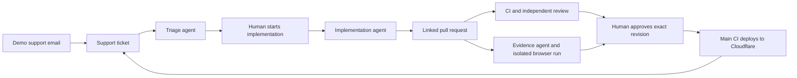

# Relay · Support to shipped

[](https://github.com/Huti-K/agentic-cicd-template/actions/workflows/ci.yml)
[](https://github.com/Huti-K/agentic-cicd-template/actions/workflows/agent-review.yml)

**A ticket workspace where a customer conversation becomes a reviewed, demonstrated, deployed improvement.**

Relay combines a browser interface, a Cloudflare Worker with D1 storage, and GitHub Actions agents. Anyone can view the workspace. Maintainers sign in to create tickets, run agents, leave feedback, and approve a specific pull request revision for merging.

[**Open Relay**](https://relay-agent-platform.oktami.workers.dev) · [Support inbox](https://relay-agent-platform.oktami.workers.dev/inbox.html) · [GitHub repository](https://github.com/Huti-K/agentic-cicd-template)

## The product

| View | What it does |
| --- | --- |
| Overview | Current tickets, review queue, active agents, and deployed revision |
| Tickets | Search and filters; a full ticket view with description, tags, assignment, contributors, and discussion |
| Implementation brief | AI triage summary, acceptance criteria, relevant code, and documentation |
| Agent workflow | Real queued/running/completed/failed jobs with GitHub Actions links |
| Pull request and evidence | Current revision, actual checks, independent review, changed files, reports, and test recording artifacts |
| Support inbox | A fictional incoming email creates a real ticket and starts triage; no email is sent |
| Local playground | The previous fictional multi-project demo, preserved at `/showcase.html` |

## From request to release

1. **Create a ticket** with a useful description, priority, tags, assignee, and contributors. Or simulate an incoming customer email in **Support inbox**.
2. **Mention a teammate** with `@` in the discussion. Recognized mentions add that person as a ticket contributor; they do not grant repository permissions.
3. **Mention `@ai`** to start a GitHub Actions triage run. The agent refines the description, identifies relevant files and documentation, and writes acceptance criteria.
4. **Start implementation** when the brief is ready. A separate agent proposes a change and attaches a real pull request to the ticket.
5. **Inspect automatic evidence** for the current PR revision. A separate agent writes end-to-end tests; another runner executes them. Open the resulting GitHub artifacts to inspect reports and recordings. Use **Generate evidence** to retry a failed evidence run.
6. **Review the result.** Leave a **Feedback** comment to request another implementation pass. Use **Switch to human editing** to pause agent work and make manual changes, then **Resume agents** when ready.
7. **Approve and merge** a specific revision once its checks, independent review, and evidence are ready. The server checks these conditions again immediately before merging.
8. **Follow deployment.** Successful main-branch CI deploys the platform to Cloudflare and verifies the deployed commit. A ticket becomes deployed only when its merged change is included in that deployment.

A mention on a ticket with an existing PR requests an implementation revision. Human editing pauses automatic comment-triggered work. Failed runs and unavailable GitHub data remain visible; Relay does not invent passing checks, completed jobs, or test recordings.

[Platform walkthrough and troubleshooting](docs/PLATFORM-GUIDE.md) · [Architecture](docs/ARCHITECTURE.md) · [Testing](docs/TESTING.md) · [API contract](docs/PLATFORM-CONTRACT.md)

## Access and credentials

The platform is **public to view, maintainer-only to change**. Maintainer sign-in uses a server-managed session cookie and CSRF protection. Sign out when finished on a shared computer.

GitHub, OpenAI, deployment, and callback credentials belong in Cloudflare or GitHub Actions secrets. They are never embedded in browser assets, saved in browser local storage, or sent to candidate application/test execution jobs. A contributor name is a workspace identity, not a GitHub permission grant.

The agent jobs use the OpenAI API and can incur costs. Runtime and concurrency limits bound individual runs; configure API project budgets separately.

## Develop and verify

Requires Node.js 22+. Browser code has no JavaScript runtime dependencies. Wrangler, Playwright, and YAML are pinned development tools.

```sh
npm ci --ignore-scripts
npm run check
npx playwright install chromium
npm run test:browser
npm run tools:install
npm run lint:workflows
npm run scan:secrets
```

`npm run check` runs syntax validation, Node tests, and the static build. Browser tests exercise desktop and mobile against test-only API fixtures. Backend integration tests use isolated temporary databases and mock GitHub responses; they do not create real issues, paid runs, or merges.

The full platform needs the Worker and its D1 binding. Run `npm run dev:platform` to build assets, initialize the local D1 database, and start Wrangler. A static-only preview (`npm run dev`) can serve `/showcase.html` and `/pipeline.html`; it does not provide the authenticated `/api` backend.

Use the [platform guide](docs/PLATFORM-GUIDE.md) for local setup and operator configuration. A secret scan examines the checked-out and fetched Git history; it is not proof that a key was never exposed elsewhere.

## Automation boundaries



- Preparation, AI work, verification, and publication use separate jobs. Candidate code never receives repository write, callback, or deployment credentials.
- AI changes are restricted to the allowed application and test paths. Evidence generation can only propose agent browser tests.
- New features need real tests. Bug fixes need regression evidence when existing entry points support reproduction.
- The publisher validates artifacts before applying changes and does not execute candidate code.
- Reviews and evidence are tied to a PR head. A new commit requires fresh evidence and review.
- Stale or duplicate callbacks cannot overwrite newer ticket work. Human editing cancels the ticket's active automation.
- Merge is an explicit human action. Passing checks alone do not authorize it.

The earlier issue-label workflow and local playground remain available for historical demonstrations. [PR #12](https://github.com/Huti-K/agentic-cicd-template/pull/12) is an intentionally bad, unmerged example against the previous Stockroom application; do not merge it into Relay.

## Attribution

Adapted from [whyisjake/agentic-deployment-template](https://github.com/whyisjake/agentic-deployment-template), revision `4e230e5370a34ed7abfd4bb7134db5d6c073a2b9`. The upstream MIT license is retained; see [LICENSE](LICENSE). Locally served DM Sans and Manrope fonts retain their SIL Open Font License files in [`demo/fonts`](demo/fonts).
