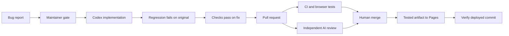

# Agentic delivery lab

[](https://github.com/Huti-K/agentic-cicd-template/actions/workflows/ci.yml)
[](https://github.com/Huti-K/agentic-cicd-template/actions/workflows/agent-review.yml)

**An agent writes the fix. Independent checks prove the behavior. A human decides what ships.**

A working example of issue → Codex patch → regression proof → pull request → independent review → human merge → verified GitHub Pages deployment.

[**Explore the pipeline**](https://huti-k.github.io/agentic-cicd-template/pipeline.html) · [Try Stockroom](https://huti-k.github.io/agentic-cicd-template/) · [Watch Actions](https://github.com/Huti-K/agentic-cicd-template/actions) · [Report a bug](https://github.com/Huti-K/agentic-cicd-template/issues/new?template=bug.yml)

## Follow the evidence



| Stage | Evidence you can inspect |
| --- | --- |
| Issue authorization | Required reproduction fields, maintainer permission, duplicate PR protection |
| Agent fix | A bounded attempt; only demo source and demo tests can be published |
| Regression proof | New assertions fail on the original source; syntax/import errors don't count |
| CI | Node 22 and 24 checks, desktop/mobile browser flows, workflow validation, redacted secret scan |
| AI review | Clear verdict, severity, exact source links, and actionable findings |
| Deployment | The browser-tested artifact plus a public build manifest and post-deploy checks |

The [pipeline page](https://huti-k.github.io/agentic-cicd-template/pipeline.html) shows real public GitHub runs and the version being viewed. It uses no browser credentials. API outages and rate limits are shown explicitly.

## Run it locally

Requires Node.js 22+. The browser application has no runtime dependencies. Playwright and YAML are development tools, pinned in the lockfile.

```sh
npm ci --ignore-scripts
npm run check
npm run dev
```

Open http://127.0.0.1:4173 for Stockroom or http://127.0.0.1:4173/pipeline.html for the delivery lab. Inventory is held in memory and resets on refresh.

To run the additional CI checks:

```sh
npx playwright install chromium
npm run test:browser
npm run tools:install
npm run lint:workflows
npm run scan:secrets
```

Browser tests use the build produced by `npm run check`. Tool installation supports Linux and macOS and verifies committed SHA-256 digests for actionlint and Gitleaks. The secret scan covers fetched Git history; it cannot establish that a credential was never exposed elsewhere.

## Showcase walkthrough

1. Open the pipeline page and follow a real run into Actions.
2. Inspect [the barcode fix](https://github.com/Huti-K/agentic-cicd-template/pull/7) and [stock validation fix](https://github.com/Huti-K/agentic-cicd-template/pull/11). These demonstrate agent-created patches and regression tests.
3. Compare [PR #12](https://github.com/Huti-K/agentic-cicd-template/pull/12): ordinary CI passed, but the independent reviewer caught a valid zero-stock operation being rejected. Leave that intentionally incorrect example unmerged.
4. Open a new, reproducible bug report. A maintainer adds `agent-ready` or manually dispatches **Codex issue fix** with the issue number.
5. Inspect **regression-evidence** on the implementation run, then the PR's **verify** and **AI review** results. Download **browser-report** for failure screenshots/traces and **site-preview** for the build.
6. Merge after human review. Main CI publishes Pages, checks its commit and assets, and records the deployment URL in the run summary.

The original starter barcode bug is fixed in the upgraded application. Use a genuinely new report for another agent run. See [Testing](docs/TESTING.md) for the demonstration and historical fixture.

## Configure your own repository

1. Use this template, then add **OPENAI_API_KEY** as an Actions secret. GitHub Actions uses API billing; it does not copy a local ChatGPT login.
2. Run `bash scripts/setup-github.sh OWNER/REPO --pages` to create labels, enable Actions-created PRs, and configure Pages.
3. Require **verify** and **AI review** in branch protection, with branches up to date before merging. Keep human merge decisions.
4. Replace the repository links and the local-development repository fallback in `demo/src/pipeline.js` and `scripts/build.mjs`.
5. Optionally set **CODEX_MODEL** and **CODEX_VERSION** repository variables. An empty value uses the action's default model or current CLI release. Implementation and review use medium reasoning effort.

Implementation has a 15-minute job limit; review has 10 minutes. These are runtime limits, not spending caps. Configure API project budgets separately.

## Operational boundaries

- PR CI has no API secret. Agent tests run on a fresh runner without write credentials.
- The publisher applies an allowlisted patch and never executes candidate demo code or tests.
- Review reads the exact PR diff against trusted base source; it never executes candidate code. Closed PRs or changed heads/bases discard the result.
- Draft PRs and Dependabot events don't start automatic paid reviews. A maintainer can dispatch review for a ready Dependabot PR. Fork PRs receive CI but require a separate trusted review process.
- Actions use immutable commit pins. Dependabot groups Actions and development dependency updates.
- Only a successful main-branch build can deploy. Failed, skipped, or cancelled required CI jobs fail the stable `verify` gate.
- AI errors and malformed results fail closed. There is no automatic merge or recursive repair loop.

[Architecture and troubleshooting](docs/ARCHITECTURE.md) explains the trust boundaries and recovery steps. The official [Codex GitHub Action documentation](https://learn.chatgpt.com/docs/github-action) describes the integration.

## Attribution

Adapted from [whyisjake/agentic-deployment-template](https://github.com/whyisjake/agentic-deployment-template), revision `4e230e5370a34ed7abfd4bb7134db5d6c073a2b9`. This version retains the structured issue and maintainer-gated execution approach, replaces the Claude-specific workflows with Codex jobs, and adds the demo, independent verification, review, CI, and Pages deployment. The upstream MIT license is retained; see [LICENSE](LICENSE).
