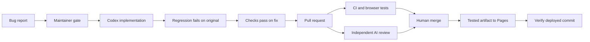

# Relay · Your work, connected

[](https://github.com/Huti-K/agentic-cicd-template/actions/workflows/ci.yml)
[](https://github.com/Huti-K/agentic-cicd-template/actions/workflows/agent-review.yml)

**A ticket workspace with fictional teams, interactive delivery flows, and a live GitHub connection.**

Relay is the main project in this agentic CI/CD learning repository. Organize tickets across four sample projects, inspect linked PRs, resolve a simulated agent finding, and follow real GitHub work from the same app.

[**Open Relay**](https://huti-k.github.io/agentic-cicd-template/) · [Live GitHub workspace](https://huti-k.github.io/agentic-cicd-template/#github) · [Explore the pipeline](https://huti-k.github.io/agentic-cicd-template/pipeline.html) · [Report a bug](https://github.com/Huti-K/agentic-cicd-template/issues/new?template=bug.yml)

Pages serves the latest successful deployment from main. An unmerged feature branch is available locally or as a CI build artifact; it does not replace the public site.

## The product

| View | What works |
| --- | --- |
| Overview | Derived totals, priority inbox, pending reviews, project progress and activity |
| Tickets | Board/list views, combined filters, search, creation/editing, assignment, due dates, status changes and desktop drag/drop |
| Pull requests | Linked tickets, checks, actionable sample agent findings, fixes, reruns and guarded merges |
| Projects and activity | Four fictional projects with progress and an event history for workspace actions |
| GitHub | Real public issues, PRs, head-commit checks/statuses, reviews, agent conversation comments and workflow runs |
| Delivery lab | Actual Actions runs and the deployed build's commit manifest |

Sample edits persist in this browser. Invalid saved data recovers to the initial sample workspace; unavailable storage falls back to the current session. Reset requires confirmation and affects only sample data.

Sample checks and agent reviews are simulations. A merge requires passing checks and an approved review; applying a fix invalidates both. The merge completes its linked ticket.

## GitHub connection

The **GitHub** view defaults to this repository and accepts any public `owner/repository` or GitHub repository URL. It fetches public data directly using credential-free GET requests. **Refresh** retrieves newer changes. The selected repository is remembered locally.

Writes happen on GitHub: create or edit issues, discuss/review PRs, and merge using the provided links. **Draft on GitHub** prepares an issue from a sample ticket; you review and submit it on GitHub. Sample actions never modify a repository.

No PAT, OAuth secret, or API key belongs in browser code or local storage. Private repositories and editing GitHub directly inside Relay would require a separate authenticated backend. This Pages version supports public repositories.

Responses are cached in memory for one minute. Lists show recent records (up to 100 per issue/PR endpoint and 20 workflow runs); PR details show up to 100 entries per category. Rate limits and outages are explicit. A failed refresh retains the last successful snapshot with a stale-data notice. See the [GitHub REST rate-limit documentation](https://docs.github.com/en/rest/using-the-rest-api/rate-limits-for-the-rest-api).

## Run locally

Requires Node.js 22+. The browser application has no runtime dependencies; Playwright and YAML are pinned development tools.

```sh
npm ci --ignore-scripts
npm run check
npm run dev
```

Open http://127.0.0.1:4173 for Relay or http://127.0.0.1:4173/pipeline.html for the delivery lab.

```sh
npx playwright install chromium
npm run test:browser
npm run tools:install
npm run lint:workflows
npm run scan:secrets
```

Browser tests use the build produced by `npm run check`. Tools support Linux/macOS and are checked against committed SHA-256 digests. The secret scan covers fetched Git history; it cannot establish that a credential was never exposed elsewhere.

[Testing and showcase walkthrough](docs/TESTING.md) covers the product flow, tests, historical agent PRs, and new issue demonstrations.

## The real automation behind it

An agent writes a fix. Independent checks prove the behavior. A human decides what ships.



| Stage | Evidence |
| --- | --- |
| Authorization | Reproduction fields, maintainer permission, duplicate PR protection |
| Implementation | One bounded attempt; only demo source and demo tests can be published |
| Regression proof | New assertions fail on original source; import/syntax errors do not count |
| CI | Node 22/24, desktop/mobile browsers, workflow validation, redacted secret scan |
| AI review | Verdict, severity, exact source links and actionable findings |
| Deployment | Tested artifact, build manifest and post-deploy checks |

## Configure your own repository

1. Use this template, then add **OPENAI_API_KEY** as an Actions secret. GitHub Actions uses API billing; it does not copy a local ChatGPT login.
2. Run `bash scripts/setup-github.sh OWNER/REPO --pages` to create labels, enable Actions-created PRs, and configure Pages.
3. Require **verify** and **AI review** in branch protection, with branches up to date before merging. Keep human merge decisions.
4. Replace the repository links and the local-development repository fallback in `demo/src/github.js`, `demo/src/pipeline.js` and `scripts/build.mjs`.
5. Optionally set **CODEX_MODEL** and **CODEX_VERSION** repository variables. An empty value uses the action's default model or current CLI release. Implementation and review use medium reasoning effort.

Implementation has a 15-minute job limit; review has 10 minutes. These are runtime limits, not spending caps. Configure API project budgets separately.

## Operational boundaries

- PR CI has no API secret. Agent tests run on a fresh runner without write credentials.
- The publisher applies an allowlisted patch and never executes candidate demo code or tests.
- Review reads the exact PR diff against trusted base source; it never executes candidate code. Closed PRs or changed heads/bases discard the result.
- Draft PRs and Dependabot events don't start automatic paid reviews. A maintainer can dispatch review for a ready Dependabot PR. Fork PRs receive CI but require a separate trusted review process.
- Actions use immutable commit pins. Dependabot groups Actions and development dependency updates.
- Only a successful main-branch build can deploy. Failed, skipped, or cancelled required CI jobs fail the stable `verify` gate.
- AI errors and malformed results fail closed. There is no automatic merge or recursive repair loop.

[Architecture and troubleshooting](docs/ARCHITECTURE.md) explains the trust boundaries and recovery steps. The official [Codex GitHub Action documentation](https://learn.chatgpt.com/docs/github-action) describes the integration.

## Attribution

Adapted from [whyisjake/agentic-deployment-template](https://github.com/whyisjake/agentic-deployment-template), revision `4e230e5370a34ed7abfd4bb7134db5d6c073a2b9`. This version retains the structured issue and maintainer-gated execution approach, replaces the Claude-specific workflows with Codex jobs, and adds the demo, independent verification, review, CI, and Pages deployment. The upstream MIT license is retained; see [LICENSE](LICENSE).
